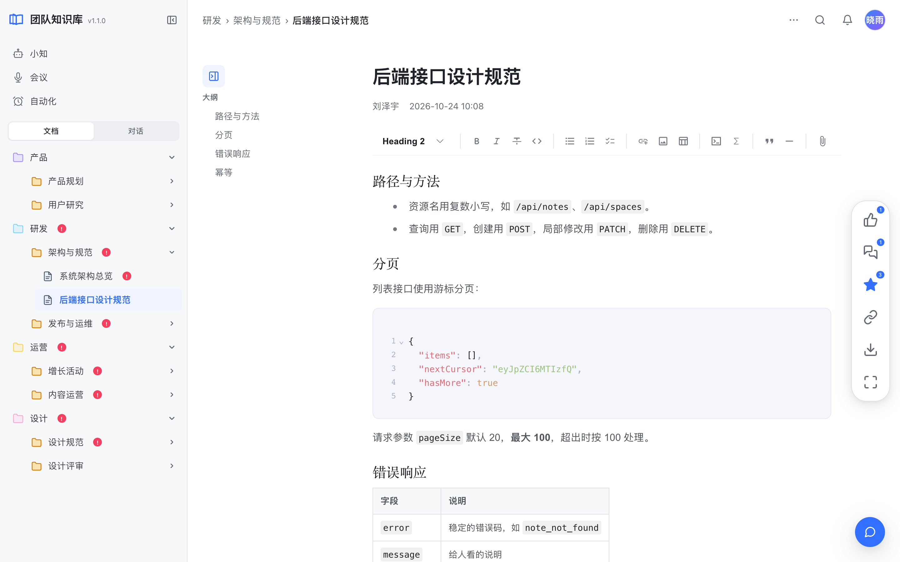
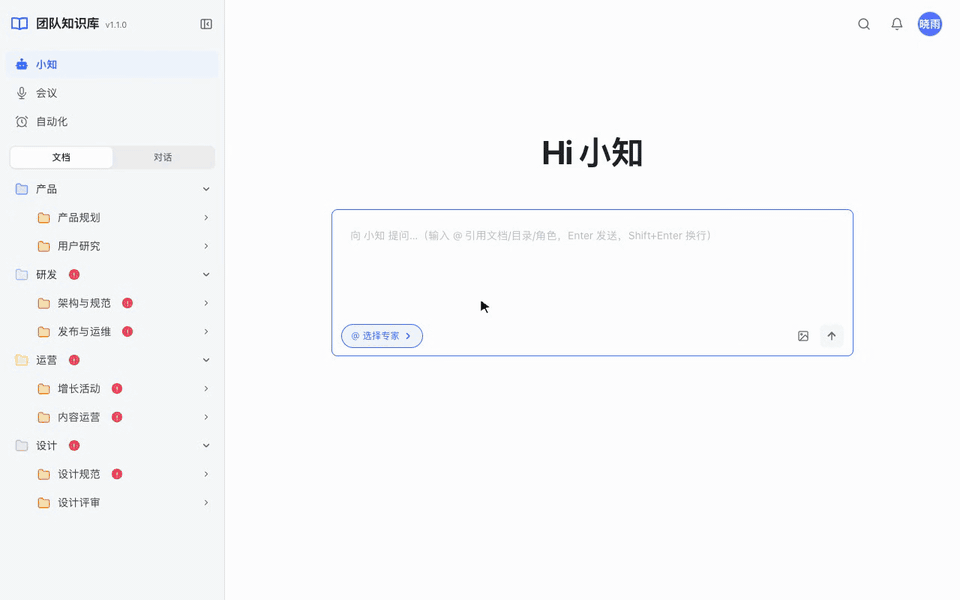
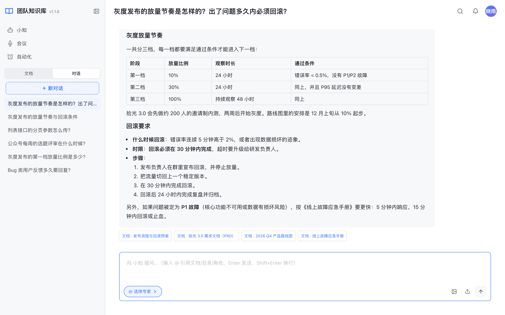
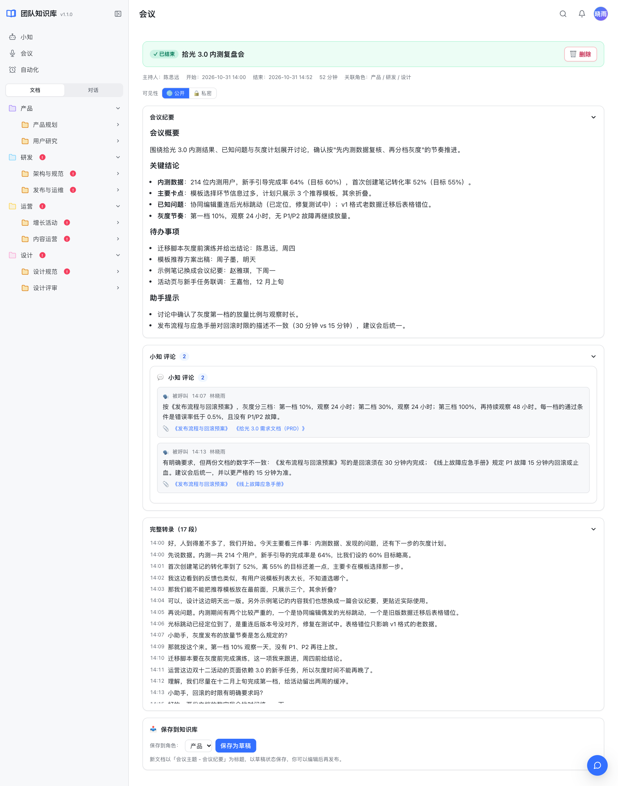
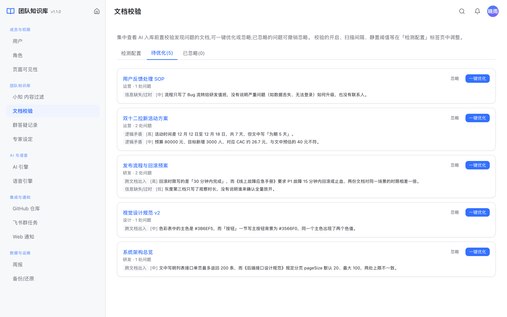
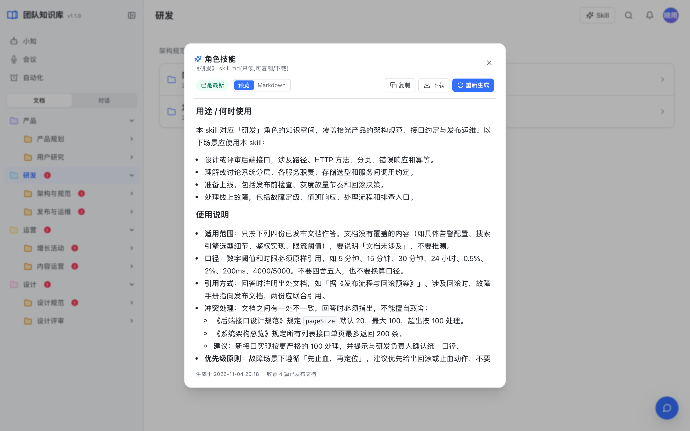
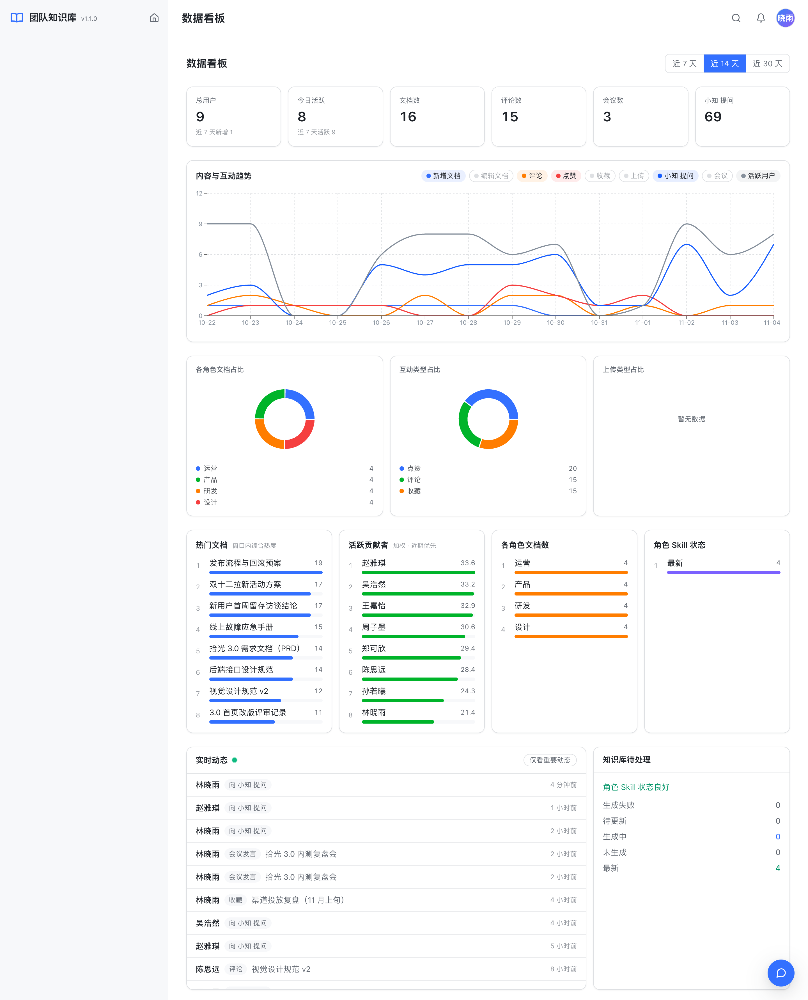
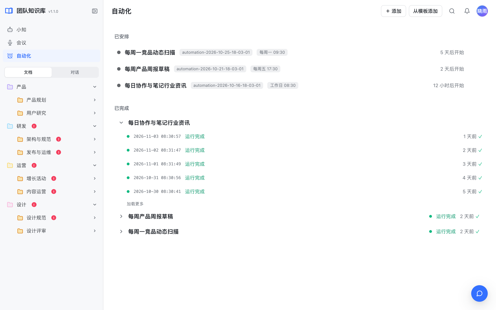
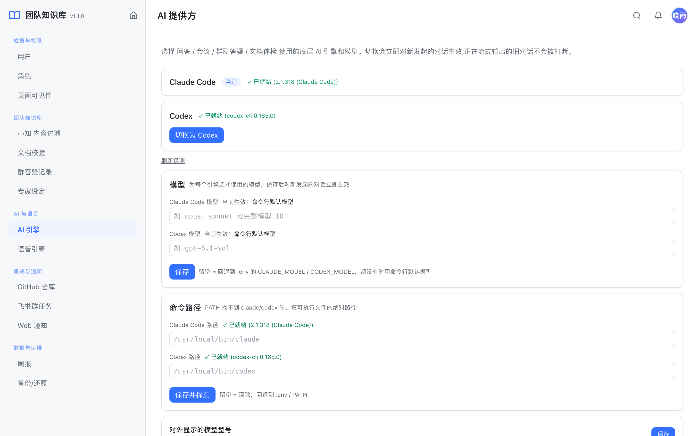
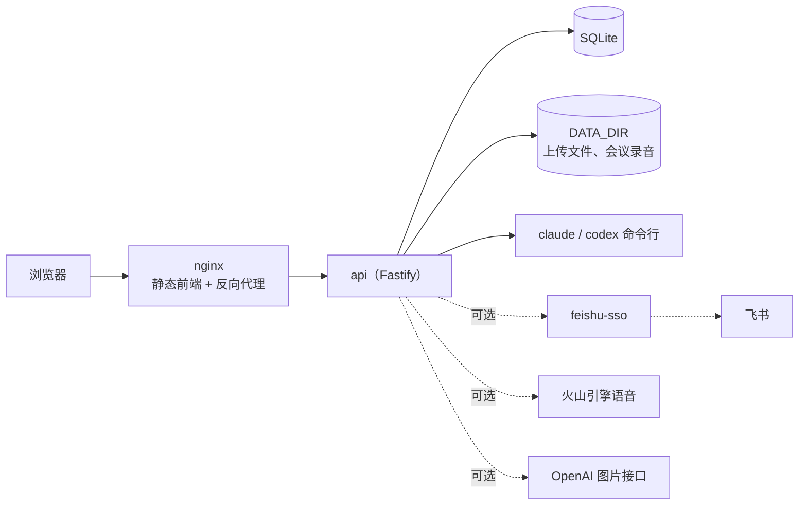

# team-knowledge

[English](README.md) | 简体中文

带 AI 助手的团队知识库：按「角色 → 目录 → 文档」组织团队知识，AI 助手基于知识库回答问题并标注出处，还能参与会议、定期体检文档、把知识整理成可直接给 Claude / Codex 使用的 skill。可以自建部署，数据都在你自己的服务器上。



- **知识库**：角色、两级目录、文档三层组织，登录成员可阅读全部文档，角色决定编辑权；Markdown 编辑器打开即编辑、自动保存；历史版本回滚、回收站；全文检索、点赞评论收藏、协同编辑者；拖入 .md 导入
- **AI 问答**：基于知识库检索作答并附引用，多轮对话、图片提问、生成图片；可以按「专家」限定检索范围
- **会议助手**：实时语音转写，说出唤醒词（默认「小助手」，可用 `WAKE_WORDS` 配置）即可提问，助手结合知识库回答并朗读；会后生成纪要，可存为文档
- **文档质量**：单篇文档编辑后由 AI 校验，工作日定时通读全库找出矛盾、错误与可优化点，支持一键优化
- **角色 Skill**：把每个角色的文档汇总成 skill.md，可复制下载，内容变化后自动重新生成
- **自动化**：定时运行 AI 任务（如每日资讯、每周周报），结果站内通知或推送飞书群
- **数据看板与通知**：概览、趋势、排行、实时动态；站内通知与浏览器桌面通知；个人主页与动态
- **中英文界面**：默认跟随浏览器语言，头像菜单里可以切换；问答按提问人的界面语言回答，飞书卡片、定时报告、角色 Skill、会议纪要等共享内容使用部署语言 `APP_LANGUAGE`
- **可切换的 AI 引擎与模型**：在 Claude Code 与 Codex 两个命令行引擎间切换，并为每个引擎选择模型（如 `opus`、`sonnet`），保存后立即生效
- **可选飞书集成**（经由同系列开源项目 [feishu-sso](https://github.com/AI-Pocket-Verse/feishu-sso)）：飞书登录、导入飞书云文档、飞书机器人私聊与群聊问答、群聊旁听答疑、各类飞书群推送

技术栈：Fastify + Prisma（SQLite）后端，React + Vite + Tailwind + Milkdown 前端，pnpm workspace 管理。

界面支持中文与英文，只有浅色主题，面向桌面浏览器（建议窗口宽度 1024px 以上），暂不适配手机窄屏与深色模式。前端不从外部加载字体等资源，内网也能正常使用。

## 演示

两分钟走一遍主要功能：向助手提问、打开并编辑文档、评论与搜索、角色 Skill、会议与 AI 纪要、自动化、文档校验、数据看板、切换 AI 引擎与模型、切换界面语言。等待 AI 回答的部分加速 5 倍，其余为实际速度。



## 截图

**AI 问答**：检索知识库作答，回答下方列出引用的文档，点击即可跳转原文。



**会议助手**：实时转写，会后由 AI 生成纪要，可一键存为文档。



**文档质量**：AI 找出文档里的矛盾、错误与可优化点，并给出修改建议。



**角色 Skill**：把一个角色下的全部文档汇总成 skill.md，可直接交给 Claude / Codex 使用。



**数据看板**：文档与问答趋势、贡献排行、实时动态。



**自动化**：定时让 AI 执行任务，结果推送到站内通知或飞书群。



**AI 引擎**：切换 Claude Code / Codex，并为每个引擎选择模型。



截图里的团队、成员与文档内容均为虚构。

## 架构



AI 能力通过本机已登录的 Claude Code / Codex 命令行调用，不需要在项目里配置模型 API Key。

## 外部依赖

| 程序 | 用途 | 说明 |
| --- | --- | --- |
| Node.js ≥ 20.19（推荐 22 或 24）、pnpm 9 | 运行与构建 | — |
| Claude Code CLI（`claude`，2.1.248 及以上）或 Codex CLI（`codex`） | AI 问答、会议助手、文档体检、自动化等所有 AI 能力 | 至少装一个，并用运行服务的系统用户登录一次。管理后台「AI 引擎」页里切换使用哪个、用哪个模型。**启用登录的多人部署只能用 `claude`**：`codex` 带 shell 工具，无法限制它读取服务器上的文件，所以只在本地单用户模式下可选（见下文「安全提示」） |
| 火山引擎语音（可选） | 会议实时转写与语音播报 | 在管理后台或 `.env` 填 `VOLC_STT_*` / `VOLC_TTS_*`；鉴权二选一：新版控制台只需 API Key（`VOLC_*_API_KEY`），旧版控制台用 APP ID + Access Token，字段说明见火山官方文档[大模型流式语音识别 API](https://www.volcengine.com/docs/6561/1354869)（API Key 方式按该文档实现，尚未用真实账号验证）。不配置时会议使用占位实现，无法真正转写 |
| OpenAI 图片接口（可选） | 聊天里生成图片 | 配置 `OPENAI_API_KEY`；用兼容网关时设 `OPENAI_BASE_URL`；服务器在国内等需要代理才能访问 OpenAI 时见下文「代理」 |

api 启动时会在日志里写明登录模式和 `claude` / `codex` 是否可用（`llm cli: ...`）。

## 快速开始

```bash
git clone https://github.com/AI-Pocket-Verse/team-knowledge.git
cd team-knowledge
pnpm install     # 安装依赖、生成 Prisma client、准备编辑器样式文件
pnpm bootstrap   # 复制 api/.env.example → api/.env.dev，创建本地 SQLite 数据库
pnpm dev         # 同时启动 api（:4030）和 web（:5030）
```

打开 <http://localhost:5030>。默认是**本地单用户模式**：无需登录，本地用户就是管理员，可以直接新建角色、目录和文档。

上手顺序：在管理后台「成员与权限 → 角色」页建角色 → 回到工作台为角色建目录、写文档 → 打开 AI 对话，它会检索知识库文档作答。

数据库在 `api/prisma/dev.db`，上传文件、会议录音在 `api/data/`，都已被 git 忽略。

## 模型设置

管理后台「AI 与语音 → AI 引擎」页：

1. **引擎**：在 Claude Code 与 Codex 之间切换，页面会探测命令行是否可用并显示版本。
2. **模型**：为每个引擎填写模型。Claude Code 可写别名（`opus`、`sonnet`、`haiku`）或完整模型 ID；Codex 写 codex 支持的模型名。留空时使用 `.env` 里的 `CLAUDE_MODEL` / `CODEX_MODEL`，两者都没有时用命令行自己的默认模型。页面会显示每个引擎「当前生效」的模型。
3. **命令路径**：服务以 systemd 运行时 PATH 很精简，找不到 `claude` / `codex` 时在这里填可执行文件的绝对路径。
4. **对外显示的模型型号**：飞书群答疑卡片、角色 Skill 卡片上显示的模型名，旁边给出从命令行实际检测到的模型，便于核对。

切换引擎或模型都对新发起的对话立即生效，正在输出的对话不会被打断。会话摘要这类后台任务默认用 `claude-haiku-4-5`，可用 `SUMMARY_MODEL` 修改，或设 `SUMMARY_PROVIDER=main` 与主模型保持一致。

## 常用命令

| 命令 | 作用 |
| --- | --- |
| `pnpm dev` | 本地开发（web 通过 Vite 代理访问 api、上传文件与会议 WebSocket） |
| `pnpm build` | 构建 api（`api/dist`）和 web（`web/dist`） |
| `pnpm typecheck` | 全部包类型检查 |
| `pnpm test` | 全部单元测试（api 测试使用独立的 `api/prisma/test.db`） |
| `pnpm --filter @team-knowledge/api db:migrate` | 修改 `api/prisma/schema.prisma` 后生成并应用迁移 |
| `pnpm --filter @team-knowledge/api cleanup-uploads` | 清理无人引用的上传文件（可加 `-- --dry-run`；生产用 `cleanup-uploads:prod`） |

## 配置

api 用 Node 原生的 `--env-file` 加载配置：`pnpm dev` 读 `api/.env.dev`，`pnpm start` 读 `api/.env.prod`。两者都不入库，模板是 [`api/.env.example`](api/.env.example)。

| 变量 | 默认 | 说明 |
| --- | --- | --- |
| `DATABASE_URL` | — | SQLite 路径，相对路径以 `api/prisma/` 为基准；生产建议写绝对路径 |
| `DATA_DIR` | `./data` | 上传文件、会议录音与语音的目录；生产必须改成源码目录之外的绝对路径，否则拒绝启动 |
| `HOST` / `PORT` | `127.0.0.1` / `4030` | api 监听地址 |
| `TRUST_PROXY` | `loopback` | 信任哪些反向代理传来的 `X-Forwarded-*`（Fastify `trustProxy` 语法：`loopback`、IP/网段、逗号分隔列表；Fastify 已不再信任跳数写法，填数字会在启动时报错）。api 前面是同机 nginx 时保持默认；不要设成 `true`，否则客户端能伪造来源 IP 绕过限流 |
| `WEB_ORIGIN` | `http://localhost:5030` | 前端来源，用于跨域白名单 |
| `WEB_PUBLIC_URL` | `http://localhost:5030` | 用户访问前端的地址（部署在子路径时含路径前缀，且 `/api` 也要反代在同一前缀下），通知卡片里的链接、会议纪要存为文档时的录音下载链接用它拼 |
| `CLAUDE_BIN` / `CODEX_BIN` | `claude` / `codex` | AI 命令行路径，也可在管理后台修改 |
| `CLAUDE_MODEL` / `CODEX_MODEL` | 空 | 各引擎默认使用的模型，留空用命令行默认模型；管理后台可以覆盖，见上文「模型设置」 |
| `APP_LANGUAGE` | `zh` | 部署语言 `zh` / `en`：飞书卡片与群推送、定时体检与报告、角色 Skill、会议纪要按它输出，没带界面语言的请求（飞书机器人、脚本）也按它回答；每个人的网页界面跟随自己的浏览器语言或头像菜单里的选择 |
| `ASSISTANT_NAME` | `AI` | 助手的显示名，用于界面、提示词和飞书卡片，web 从 `/api/me` 获取 |
| `WAKE_WORDS` | `小助手` | 会议唤醒词，逗号分隔，转写里出现任意一个即触发助手回答；英文会议可设为 `hey assistant` 之类 |
| `WHOAMI_URL` | 未设置 | 设置后启用飞书登录与飞书能力，见下文 |
| `ADMIN_OPEN_IDS` / `ADMIN_EMAILS` / `ADMIN_PHONES` | 空 | 启用登录后，首次登录即成为管理员的名单 |
| `INTERNAL_API_TOKEN` | 开发占位值 | 与 feishu-sso 的服务间口令，两边必须一致；为空时拒绝所有内部请求；启用登录后为空或仍是占位值时：生产环境、或 `HOST` 监听本机以外的地址时拒绝启动，只监听本机的开发环境在日志里警告 |
| `FEISHU_*_CHAT_IDS` | 空 | 各类飞书群推送的目标群，见 `.env.example`；也可在管理后台按场景配置 |
| `VOLC_STT_*` / `VOLC_TTS_*` | 空 | 火山引擎语音凭据，也可在管理后台填写。`*_API_KEY`（新版控制台）与 `*_APP_ID` + `*_ACCESS_TOKEN`（旧版控制台）二选一，配置了 API Key 就优先用它。另有 endpoint、resource id、音色、热词等可选项，见 `.env.example`。管理后台读取凭据时只显示末 4 位 |
| `OPENAI_API_KEY` | 空 | 聊天生成图片，在 OpenAI 平台 [API keys](https://platform.openai.com/api-keys) 页面创建 |
| `OPENAI_BASE_URL` | `https://api.openai.com/v1` | 图片接口地址，用兼容网关或自建代理时设置；模型、尺寸、超时等调参项见 `.env.example` |
| `NODE_USE_ENV_PROXY` / `HTTPS_PROXY` | 空 | 访问 OpenAI 需要走代理时必须**同时**设置，见下文「代理」 |
| `LLM_*_TIMEOUT_MS` / `LLM_EFFORT` | 见 `.env.example` | AI 命令行的无输出超时、总时长上限和推理强度 |
| `SUMMARY_MODEL` / `SUMMARY_PROVIDER` | `claude-haiku-4-5` / 空 | 会话摘要用的模型；`SUMMARY_PROVIDER=main` 时与主模型一致 |

**代理**：Node 内置的 `fetch` 默认不读系统代理。服务器需要代理才能访问 OpenAI 时，在 `.env.prod` 里同时写 `NODE_USE_ENV_PROXY=1` 和 `HTTPS_PROXY=http://<代理地址>:<端口>`，只设 `HTTPS_PROXY` 不会生效，聊天生成图片会一直提示「暂不可用」。

## 安全提示

- **本地模式不鉴权**：能访问到 api 的人都能读写全部知识库、调用你登录的 AI 命令行，所以 `HOST` 默认只监听本机（本地模式监听其他地址时 api 会在日志里告警），并且只接受 `localhost` / 回环地址以及 `WEB_ORIGIN`、`WEB_PUBLIC_URL` 里的主机名作为 `Host`（防止恶意网页用 DNS 重绑定访问本机服务，其他主机名返回 421）。要在局域网里用别的域名访问，请把它写进 `WEB_ORIGIN`；多人使用请接入下面的飞书登录。
- **`claude` 引擎在隔离环境里运行**：每次调用都带 `--restricted --safe-mode --strict-mcp-config` 和显式的 `--tools` 名单，并在空的临时目录里运行：没有能执行命令的工具，文件工具只能访问这个目录（带图提问时只把本次图片复制进去），也不加载服务用户自己的 Claude Code 设置、hooks、`CLAUDE.md` 和 MCP 服务器。因此成员本人或藏在文档、网页里的提示词注入，都无法让它读取 `.env`、数据库或服务器上的其他文件；api 自己的密钥也不会传进它的环境变量。需要 Claude Code 2.1.248 及以上，版本过低时「AI 引擎」页会显示未就绪。
- **`codex` 引擎**：`codex` 带 shell 工具，即使只读沙箱也能读到服务器上的任意文件（包括 `.env.prod`）。因此启用了登录（设置了 `WHOAMI_URL`）时只允许 `claude` 引擎：管理后台的 `codex` 切换按钮置灰并写明原因（接口同样拒绝），库里残留的 `codex` 设置在启动时会回退为 `claude` 并写日志。本地模式下仍可用 `codex`，调用时会加 `--sandbox read-only`、在空的临时目录里运行，并且只传 `PATH`、`HOME`、语言和代理等必需环境变量，不继承 `.env` 里的密钥；因此 codex 要用运行服务的系统用户执行一次 `codex login`（凭据在 `CODEX_HOME`，默认 `~/.codex`），`OPENAI_API_KEY` 环境变量不会传给它。
- **后台填的命令路径会校验**：文件名必须是 `claude` / `codex`，且 `--version` 输出必须是对应 CLI 的格式，知识库管理员无法借这项设置在服务器上运行任意程序。
- **助手联网**：问答与自动化可以使用 `WebSearch` / `WebFetch`，这些请求能否访问内网取决于 Claude Code 自身。服务器旁边有敏感的内网服务时，请在网络层做出口过滤（屏蔽私网网段与云厂商元数据地址）。
- **模型 ID 校验**：后台与 `.env` 里填的模型 ID 会作为命令行参数传给 CLI，只允许字母、数字和 `. _ - : / [ ]`，且必须以字母或数字开头，不会被当成其他命令行参数。
- **登录成员可读全部文档**：知识库没有「私有目录」，任何登录成员都能阅读全部文档，角色只决定谁能编辑。文档只有作者或管理员能删除，因此成员只能删除里面全是自己文档的目录。需要限制谁能进来，请在 feishu-sso 一侧限制可登录的范围。会议的「私密」可见性是生效的：私密会议只有创建者能看，纪要不会推送到飞书群（「会议纪要群通知」在管理后台开启，默认关闭），也不会被 AI 助手检索引用；进行中的会议改为私密后，已在线的围观者会被立即断开。
- **群聊旁听答疑**：机器人只回答已启用的知识库成员在被勾选群里的发言，群里的外部伙伴和已停用成员不会触发回答。答疑记录保存提问的前 80 字和群名，点赞记录保存消息前 60 字和发言人；选了专家提问时，AI 助手会检索所有群的答疑记录作为参考，任何登录成员都可能看到其他群里被问过的问题。不要把讨论敏感内容的群勾选为答疑群。
- **放开给全员的后台页**（「成员与权限 → 页面可见性」）对成员只读：群答疑记录不显示飞书群 ID 与发言人 ID，全站 Web 通知开关只有管理员能改，忽略或 AI 优化文档校验问题仍需要该文档的编辑权。
- **动态与周报**：全员可见的实时动态不显示他人的自动化名称和上传文件名；周报快照不保存会议、自动化、上传的标题。周报页放开给所有成员后仍是只读，生成和刷新只有管理员能做。
- **管理后台里存的凭据以明文保存在数据库里**：包括火山语音凭据和 GitHub 访问令牌（PAT）。请保护好数据库文件和备份，只给 PAT 最小权限，并定期轮换。
- **部署走 HTTPS**：`deploy/nginx.conf.template` 默认把 http 跳转到 https，并带 HSTS、`X-Frame-Options`、`nosniff`、`Referrer-Policy` 与 CSP 等安全响应头；api 的接口响应一律 `Cache-Control: no-store`。

发现安全问题请通过 GitHub 的 [Private vulnerability reporting](https://github.com/AI-Pocket-Verse/team-knowledge/security/advisories/new) 私下报告，不要公开提 issue。

## 可选：飞书登录与飞书能力

不设置时为本地单用户模式，飞书相关功能（导入飞书文档、机器人、群推送）不可用，会提示「未接入飞书」。需要多人使用或用飞书时，接入同系列开源项目 [feishu-sso](https://github.com/AI-Pocket-Verse/feishu-sso)：

1. 部署 feishu-sso，并让反向代理把同一域名下的 `/auth/*` 转发给它（登录 cookie 依赖同源）。`deploy/nginx.conf.template` 里留好了 include 位置。
2. api 设置 `WHOAMI_URL`，指向 feishu-sso 的 whoami 接口，例如 `http://127.0.0.1:4020/api/whoami`。读飞书文档、发飞书消息也都经由同一个地址。
3. web 构建时设置 `VITE_SSO_BASE=/auth`（可写在 `web/.env.local`）。
4. api 与 feishu-sso 设置同一个 `INTERNAL_API_TOKEN`（`openssl rand -hex 24` 生成）。
5. 设置 `ADMIN_OPEN_IDS` / `ADMIN_EMAILS` / `ADMIN_PHONES` 之一指定首位管理员；之后在管理后台给其他成员分配角色与管理员。
6. 飞书机器人：在 feishu-sso 设置 `BOT_BACKEND_URL=http://127.0.0.1:4030`（本服务的内网地址），并按 feishu-sso 的 README 开通机器人、事件与回调订阅。成员私聊或在群里 @ 机器人即可与 AI 助手对话，和网页端共享同一份会话。

接入后新成员首次登录会自动建账号，管理员会收到飞书提醒。新成员不需要角色就能阅读全部文档，分配角色后才能编辑对应角色下的内容。成员离开时请在管理后台「成员与权限 → 用户」里禁用：停用的成员不再收到站内与飞书通知，名下的自动化任务也会停止运行。有上传文件或创建过会议的用户不能删除（删除会让别人文档里的图片失效、会议丢失），只能禁用。

**登录回跳**：web 把当前页面的完整地址（与当前页同源的绝对 URL，即 `window.location.href`）作为 `return_to` 传给 feishu-sso，登录后会回到原页面，不需要在 feishu-sso 里配置 `ALLOWED_RETURN_TO`。前提是 feishu-sso 能还原浏览器访问的来源：反向代理要传 `X-Forwarded-Proto` / `X-Forwarded-Host`（本仓库的 nginx 模板已设置），feishu-sso 的 `TRUST_PROXY` 要信任该代理。详见 feishu-sso README 的 `return_to` 约定。

**内部接口**：`/api/internal/*`（飞书消息、卡片回调等）只靠 `INTERNAL_API_TOKEN` 鉴权，不应暴露到公网。nginx 模板已对外返回 404；feishu-sso 通过 `127.0.0.1:4030` 直连调用（`BOT_BACKEND_URL`）。如果 feishu-sso 在另一台机器上，请只在内网放通，不要改成经公网域名转发。

## 部署

`deploy/` 提供 systemd 与 nginx 模板（单机部署，nginx 托管前端静态文件，并把 `/api`、`/uploads` 与会议录音、语音反代给 api）：

```bash
git clone https://github.com/AI-Pocket-Verse/team-knowledge.git /opt/team-knowledge && cd /opt/team-knowledge
pnpm install && pnpm build
cp api/.env.example api/.env.prod   # 改为 NODE_ENV=production，DATABASE_URL / DATA_DIR 用绝对路径，按需配置飞书
pnpm --filter @team-knowledge/api db:migrate:prod
pnpm --filter @team-knowledge/api db:seed:prod

sudo cp deploy/systemd.service.template /etc/systemd/system/team-knowledge.service
sudo sed -i 's|__INSTALL_DIR__|/opt/team-knowledge|g; s|__SERVICE_USER__|kb|g' /etc/systemd/system/team-knowledge.service
sudo systemctl daemon-reload && sudo systemctl enable --now team-knowledge

# 先为域名签发 HTTPS 证书（例如 certbot），再把证书路径填进模板
sudo cp deploy/nginx.conf.template /etc/nginx/sites-available/team-knowledge
sudo sed -i 's|__INSTALL_DIR__|/opt/team-knowledge|; s|__SERVER_NAME__|kb.example.com|g; s|__SSL_CERT__|/etc/letsencrypt/live/kb.example.com/fullchain.pem|; s|__SSL_KEY__|/etc/letsencrypt/live/kb.example.com/privkey.pem|' /etc/nginx/sites-available/team-knowledge
sudo ln -sf /etc/nginx/sites-available/team-knowledge /etc/nginx/sites-enabled/ && sudo nginx -t && sudo systemctl reload nginx
```

运行服务的系统用户（上例为 `kb`）需要能执行 `claude` 或 `codex`，并且用该用户登录过一次；还需要能写 `DATABASE_URL` 与 `DATA_DIR` 所在目录。

**备份与还原**：管理后台「数据与运维 → 备份/还原」可以手动备份与还原数据库。备份文件放在 `DATA_DIR/backups/team-knowledge/`（手动备份在其 `manual/` 子目录，含上传文件的配套压缩包），因此 `DATA_DIR` 所在磁盘要留足空间，也别把 `DATA_DIR` 指到仓库目录里。`DATABASE_URL` 里的相对路径按 `api/prisma/` 解析（与 Prisma 一致），还原时替换的就是这个文件。还原前会先校验备份：库文件必须完整，迁移版本必须与当前代码一致，否则拒绝还原并给出原因（`backup_corrupt` / `backup_schema_outdated` / `backup_schema_newer`）；同一时间只允许一次还原。

**定时任务**：文档体检（工作日早 9 点）和周报（周五 21:00）由服务进程内部按后台配置自动推送，不需要再配系统 crontab。`api/scripts/doc-audit.ts`、`api/scripts/weekly-role-digest.ts`（用法写在文件开头）只用于手动补发，需要先接入飞书；另外配了 crontab 的话同一个群会收到两份。数据看板、活跃统计和周报都按北京时间（UTC+8）分天，与服务器时区无关。

**清理上传文件**：服务每天会自动清理一次无人引用的上传文件，也可以手动运行 `pnpm --filter @team-knowledge/api cleanup-uploads:prod -- --dry-run`（去掉 `--dry-run` 才真正删除，`--older-than-days=N` 调整保留天数，默认 7 天）。

**管理后台里的 GitHub 仓库**：周报的「研发改动」段统计管理后台「集成与通知 → GitHub 仓库」里配置的仓库本周提交，认证方式二选一：

- **访问令牌（PAT）**：公开仓库可留空；私有仓库填只读权限的 PAT（如 fine-grained token 的 Contents: Read-only）。令牌**以明文存在数据库里**（和火山凭据一样），界面只显示是否已配置、不回显；请只给最小权限、定期轮换，并保护好数据库文件和备份。
- **SSH**：使用运行服务的系统用户已有的 SSH 私钥访问（`git ls-remote` / 只拉元数据的 clone），应用不存任何密钥，适合机器上的 key 已有权限的私有仓库。

## 目录结构

```
api/        Fastify 后端：知识库、检索与问答、会议、文档体检、自动化、通知、管理后台接口
web/        React 前端（Milkdown 编辑器）
shared/     api 与 web 共用的类型与更新日志
packages/   共用小包（登录客户端、日志、数据库工具等）
deploy/     systemd / nginx 模板
docs/       README 用的截图
```

## Credits

- 生成分享图片用的中文字体为 [Noto Sans SC](https://github.com/notofonts/noto-cjk)（SIL Open Font License 1.1，见 `api/assets/fonts/OFL.txt`）。

## License

[MIT](LICENSE)
