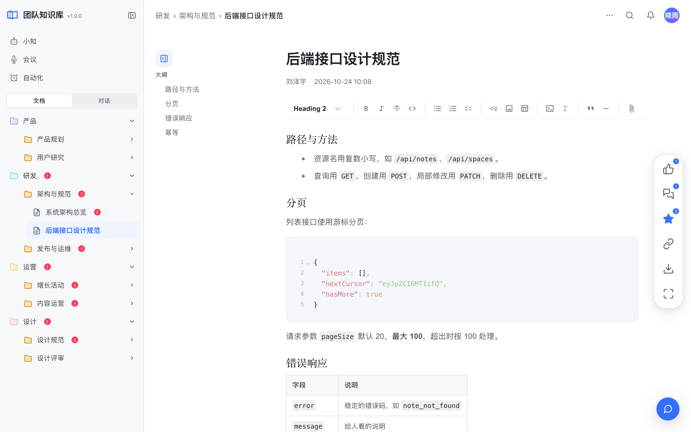
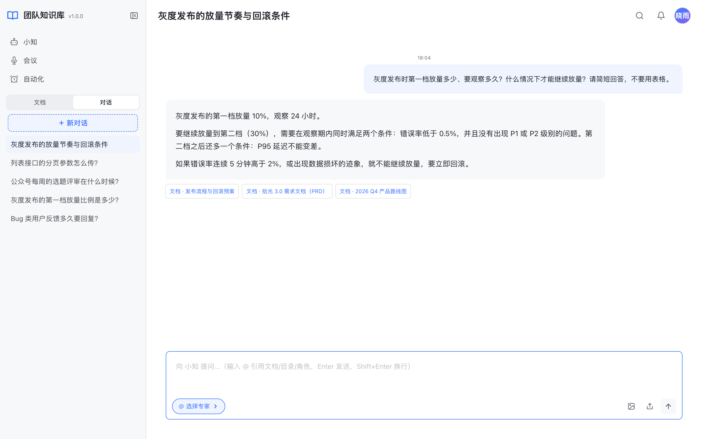
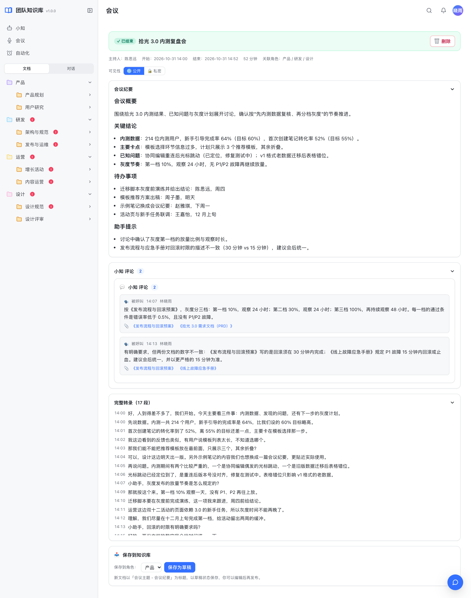
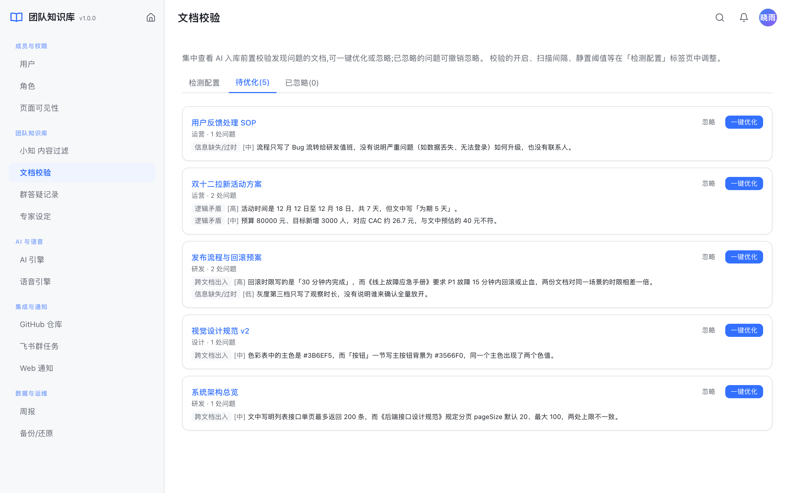
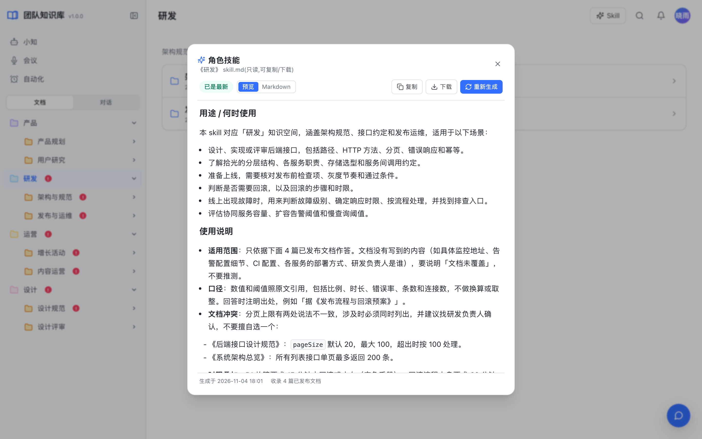
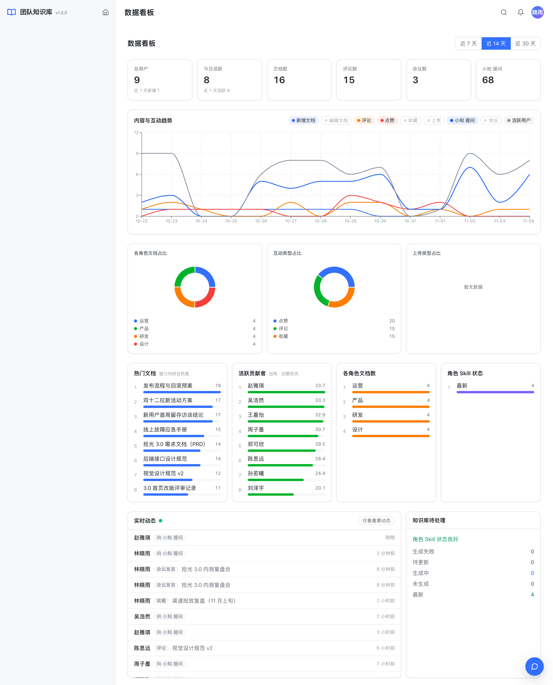
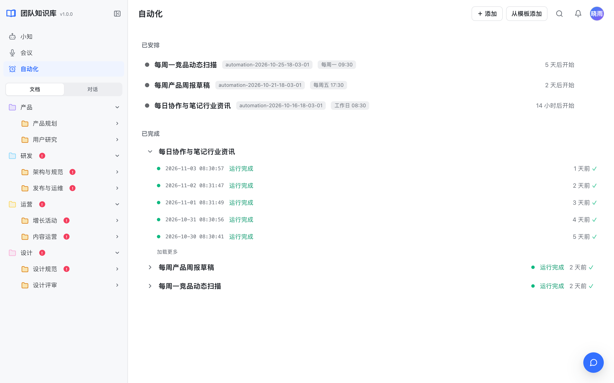
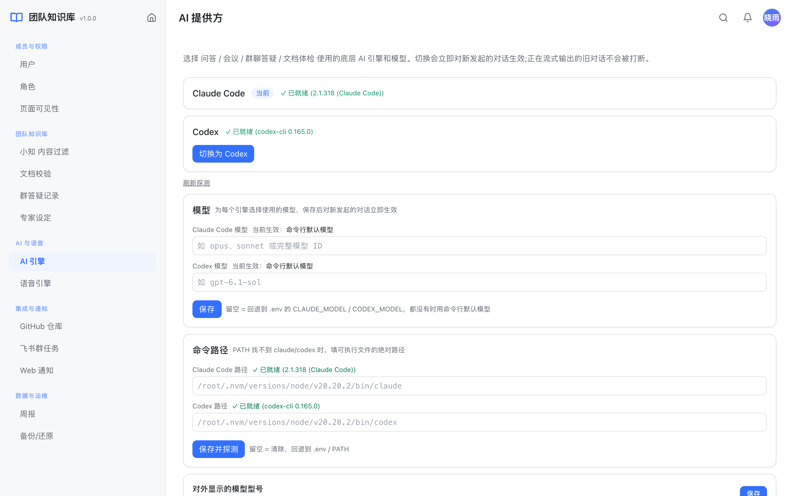
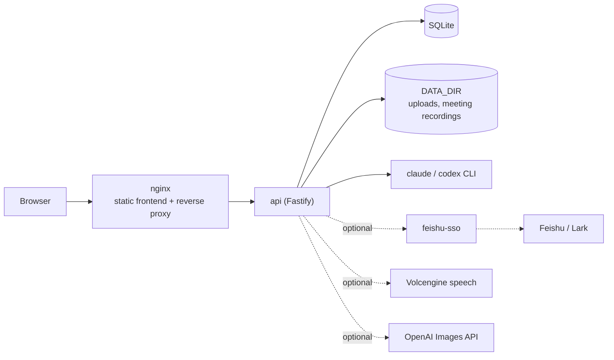

# team-knowledge

English | [简体中文](README-CN.md)

A self-hosted team knowledge base with an AI assistant. Knowledge is organized as **roles → folders → documents**; the assistant answers questions from the knowledge base with citations, joins meetings, audits documents on a schedule, and distills each role's documents into a skill file you can hand straight to Claude or Codex. Everything runs on your own server.



- **Knowledge base**: roles, two levels of folders and documents. Every signed-in member can read everything; roles decide who can edit. A Markdown editor that is always in edit mode and saves automatically, version history with rollback, a recycle bin, full-text search, likes, comments, bookmarks, co-editors, and drag-and-drop `.md` import
- **AI Q&A**: answers grounded in the knowledge base with citations, multi-turn conversations, questions about images, image generation, and "experts" that narrow retrieval to part of the knowledge base
- **Meeting assistant**: live speech-to-text; say the wake word (default `小助手`, configurable with `WAKE_WORDS`) to ask a question and the assistant answers from the knowledge base out loud; minutes are generated afterwards and can be saved as a document
- **Document quality**: every edited document is checked by the AI, and on workdays the whole knowledge base is read end to end to find contradictions, mistakes and things to improve, with one-click fixes
- **Role skills**: each role's documents are summarized into a `skill.md` you can copy or download, regenerated automatically when the content changes
- **Automations**: scheduled AI tasks (a daily news digest, a weekly report, ...) whose results go to in-app notifications or a Feishu group
- **Dashboard and notifications**: overview, trends, rankings and a live activity feed; in-app and desktop notifications; personal profile pages
- **Chinese and English UI**: follows the browser language by default and can be switched from the avatar menu; answers come back in the language of whoever asked, and shared content (Feishu cards, scheduled reports, role skills, meeting minutes) uses the deployment language `APP_LANGUAGE`
- **Switchable AI engine and model**: switch between the Claude Code and Codex CLIs and choose a model for each (for example `opus` or `sonnet`); changes apply immediately
- **Optional Feishu (Lark) integration** through the companion open-source project [feishu-sso](https://github.com/AI-Pocket-Verse/feishu-sso): Feishu login, importing Feishu docs, chatting with the bot in private and group chats, answering questions it overhears in groups, and group notifications

Stack: Fastify + Prisma (SQLite) backend, React + Vite + Tailwind + Milkdown frontend, managed as a pnpm workspace.

> The UI is available in Chinese and English, with a light theme, built for desktop browsers (1024 px wide or more); narrow mobile screens and dark mode are not supported. The frontend loads no external fonts or other resources, so it also works on an intranet.

## Screenshots

**AI Q&A**: answers come from the knowledge base, with the cited documents listed below each answer; click one to open the source.



**Meeting assistant**: a live transcript during the meeting and AI-written minutes afterwards, which can be saved as a document in one click.



**Document quality**: the AI points out contradictions, mistakes and possible improvements, with suggested edits.



**Role skills**: all documents of a role summarized into a `skill.md` that Claude or Codex can use directly.



**Dashboard**: document and Q&A trends, contribution rankings and live activity.



**Automations**: scheduled AI tasks that post their results to in-app notifications or a Feishu group.



**AI engine**: switch between Claude Code and Codex and choose a model for each.



The team, members and documents in the screenshots are fictional.

## Architecture



All AI features call the Claude Code or Codex CLI that is installed and logged in on the server, so the project itself needs no model API key.

## Requirements

| Program | Purpose | Notes |
| --- | --- | --- |
| Node.js ≥ 20.19 (22 or 24 recommended), pnpm 9 | Run and build | — |
| Claude Code CLI (`claude`, 2.1.248 or later) or Codex CLI (`codex`) | Every AI feature: Q&A, the meeting assistant, document audits, automations | Install at least one and log in once as the system user that runs the service. Choose the engine and model on the admin **AI 引擎** (AI engine) page. **Multi-user deployments with login enabled can only use `claude`**: `codex` ships with shell tools and cannot be prevented from reading files on the server, so it is only available in local single-user mode (see [Security](#security)) |
| Volcengine speech (optional) | Live meeting transcription and text-to-speech | Set `VOLC_STT_*` / `VOLC_TTS_*` in the admin console or `.env`. Authenticate with either an API key (`VOLC_*_API_KEY`, new console) or an APP ID + access token (old console); see Volcengine's [streaming ASR API docs](https://www.volcengine.com/docs/6561/1354869). The API key path follows that document but has not been tested with a real account. Without credentials meetings use a placeholder and nothing is transcribed |
| OpenAI Images API (optional) | Generating images in chat | Set `OPENAI_API_KEY`; set `OPENAI_BASE_URL` for a compatible gateway; see [Proxy](#configuration) if the server needs a proxy to reach OpenAI |

On startup the api logs the login mode and whether `claude` / `codex` can run (`llm cli: ...`).

## Quick start

```bash
git clone https://github.com/AI-Pocket-Verse/team-knowledge.git
cd team-knowledge
pnpm install     # install dependencies, generate the Prisma client, prepare editor styles
pnpm bootstrap   # copy api/.env.example to api/.env.dev and create the local SQLite database
pnpm dev         # start the api (:4030) and the web app (:5030)
```

Open <http://localhost:5030>. By default the app runs in **local single-user mode**: no login, and the local user is the admin, so you can create roles, folders and documents right away.

A good first run: create a role on the admin **成员与权限 → 角色** (Members → Roles) page → go back to the workspace and add folders and documents under that role → open the AI chat and ask a question; it searches your documents to answer.

The database lives in `api/prisma/dev.db`, uploads and meeting recordings in `api/data/`; both are ignored by git.

## Choosing the AI engine and model

Admin console → **AI 与语音 → AI 引擎** (AI & voice → AI engine):

1. **Engine**: switch between Claude Code and Codex. The page checks whether each CLI can run and shows its version.
2. **Model**: enter a model for each engine. Claude Code accepts an alias (`opus`, `sonnet`, `haiku`) or a full model ID; Codex accepts any model name your `codex` supports. Leave it empty to use `CLAUDE_MODEL` / `CODEX_MODEL` from `.env`, or the CLI's own default when those are unset too. The page shows the model currently in effect for each engine.
3. **CLI path**: under systemd the `PATH` is minimal; if `claude` / `codex` cannot be found, enter the absolute path of the executable here.
4. **Displayed model name**: the model name shown on Feishu Q&A cards and role skill cards, next to the model actually detected from the CLI so you can check they match.

Engine and model changes apply to new conversations immediately; answers that are still streaming are not interrupted. Background conversation summaries use `claude-haiku-4-5` by default; change it with `SUMMARY_MODEL`, or set `SUMMARY_PROVIDER=main` to use the main model.

## Commands

| Command | What it does |
| --- | --- |
| `pnpm dev` | Local development (the web app reaches the api, uploads and the meeting WebSocket through the Vite proxy) |
| `pnpm build` | Build the api (`api/dist`) and the web app (`web/dist`) |
| `pnpm typecheck` | Type-check every package |
| `pnpm test` | Run all unit tests (api tests use a separate `api/prisma/test.db`) |
| `pnpm --filter @team-knowledge/api db:migrate` | Create and apply a migration after editing `api/prisma/schema.prisma` |
| `pnpm --filter @team-knowledge/api cleanup-uploads` | Delete uploads nothing references (add `-- --dry-run` to preview; use `cleanup-uploads:prod` in production) |

## Configuration

The api loads its configuration with Node's built-in `--env-file`: `pnpm dev` reads `api/.env.dev` and `pnpm start` reads `api/.env.prod`. Neither is committed; the template is [`api/.env.example`](api/.env.example) (its comments are in Chinese; this table is the English reference).

| Variable | Default | Description |
| --- | --- | --- |
| `DATABASE_URL` | — | SQLite path; relative paths are resolved from `api/prisma/`. Use an absolute path in production |
| `DATA_DIR` | `./data` | Directory for uploads, meeting recordings and speech audio. In production it must be an absolute path outside the source tree, or the api refuses to start |
| `HOST` / `PORT` | `127.0.0.1` / `4030` | Address the api listens on |
| `TRUST_PROXY` | `loopback` | Which reverse proxies may set `X-Forwarded-*` (Fastify `trustProxy` syntax: `loopback`, IPs / CIDRs or a comma-separated list; hop counts are rejected at startup because Fastify no longer trusts them). Keep the default when nginx runs on the same host. Never set it to `true`, or clients can spoof their IP and bypass rate limits |
| `WEB_ORIGIN` | `http://localhost:5030` | Frontend origin, used for the CORS allowlist |
| `WEB_PUBLIC_URL` | `http://localhost:5030` | The URL users open (include the path prefix when served under a sub-path, and proxy `/api` under the same prefix). Used for links in notification cards and recording links in minutes saved as documents |
| `CLAUDE_BIN` / `CODEX_BIN` | `claude` / `codex` | CLI paths; can also be changed in the admin console |
| `CLAUDE_MODEL` / `CODEX_MODEL` | empty | Default model for each engine; empty means the CLI's default. The admin console can override it, see [Choosing the AI engine and model](#choosing-the-ai-engine-and-model) |
| `APP_LANGUAGE` | `zh` | Deployment language, `zh` or `en`: Feishu cards and group notifications, scheduled audits and reports, role skills and meeting minutes are written in it, and so are answers to requests that carry no UI language (the Feishu bot, scripts). Each person's web UI follows their browser language or their choice in the avatar menu |
| `ASSISTANT_NAME` | `AI` | Display name of the assistant in the UI, prompts and Feishu cards; the web app reads it from `/api/me` |
| `WAKE_WORDS` | `小助手` | Comma-separated meeting wake words; any of them in the transcript makes the assistant answer. For English meetings set something like `hey assistant` |
| `WHOAMI_URL` | unset | Enables Feishu login and Feishu features when set, see below |
| `ADMIN_OPEN_IDS` / `ADMIN_EMAILS` / `ADMIN_PHONES` | empty | With login enabled, users on these lists become admins on their first login |
| `INTERNAL_API_TOKEN` | development placeholder | Shared secret between the api and feishu-sso; must match on both sides. When empty, all internal requests are rejected. With login enabled and the token empty or still the placeholder, the api refuses to start in production or when `HOST` is reachable from other machines, and logs a warning in development on loopback |
| `FEISHU_*_CHAT_IDS` | empty | Target groups for the various Feishu group notifications, see `.env.example`; can also be set per scenario in the admin console |
| `VOLC_STT_*` / `VOLC_TTS_*` | empty | Volcengine speech credentials, also editable in the admin console. Use either `*_API_KEY` (new console) or `*_APP_ID` + `*_ACCESS_TOKEN` (old console); the API key wins when both are set. Optional endpoint, resource ID, voice and hot-word settings are listed in `.env.example`. The admin console only shows the last 4 characters of stored credentials |
| `OPENAI_API_KEY` | empty | Image generation in chat; create a key on the OpenAI [API keys](https://platform.openai.com/api-keys) page |
| `OPENAI_BASE_URL` | `https://api.openai.com/v1` | Images API endpoint, for a compatible gateway or your own proxy; model, size and timeout settings are in `.env.example` |
| `NODE_USE_ENV_PROXY` / `HTTPS_PROXY` | empty | Must **both** be set when OpenAI is only reachable through a proxy, see below |
| `LLM_*_TIMEOUT_MS` / `LLM_EFFORT` | see `.env.example` | CLI idle timeout, hard time limit and reasoning effort |
| `SUMMARY_MODEL` / `SUMMARY_PROVIDER` | `claude-haiku-4-5` / empty | Model for conversation summaries; `SUMMARY_PROVIDER=main` uses the main model |

**Proxy**: Node's built-in `fetch` ignores system proxy settings. If the server needs a proxy to reach OpenAI, set both `NODE_USE_ENV_PROXY=1` and `HTTPS_PROXY=http://<proxy-host>:<port>` in `.env.prod`. `HTTPS_PROXY` alone has no effect, and image generation keeps reporting that it is unavailable.

## Security

- **Local mode has no authentication.** Anyone who can reach the api can read and write the whole knowledge base and use the AI CLI you are logged in to. That is why `HOST` only listens on the loopback interface by default (the api logs a warning when local mode listens on any other address), and only `localhost` / loopback addresses and the host names in `WEB_ORIGIN` / `WEB_PUBLIC_URL` are accepted as `Host` (to stop malicious web pages from reaching the local service through DNS rebinding; other host names get a 421). To use another host name on your LAN, add it to `WEB_ORIGIN`; for multiple users, enable Feishu login below.
- **The `claude` engine runs sandboxed.** Every call passes `--restricted --safe-mode --strict-mcp-config` and an explicit `--tools` list, and runs in an empty temporary directory: no tools that run commands, file tools confined to that directory (an image question copies just its images there), and none of the service user's own Claude Code settings, hooks, `CLAUDE.md` or MCP servers are loaded. So neither a member nor prompt injection hidden in a document or web page can make it read `.env`, the database or other files on the server. The api's own secrets are also removed from its environment. This needs Claude Code 2.1.248 or later; older versions show as not ready on the AI engine page.
- **The `codex` engine** ships with shell tools and can read any file on the server even in a read-only sandbox (including `.env.prod`). With login enabled (`WHOAMI_URL` set) only the `claude` engine is allowed: the `codex` button in the admin console is disabled with an explanation, the API rejects the switch, and a leftover `codex` setting falls back to `claude` at startup with a log message. In local mode `codex` is still available; it runs with `--sandbox read-only` in an empty temporary directory and only receives the environment variables it needs (`PATH`, `HOME`, locale and proxy), never the secrets from `.env`. So run `codex login` once as the service user (credentials live in `CODEX_HOME`, `~/.codex` by default); the `OPENAI_API_KEY` environment variable is not passed to it.
- **CLI paths set in the admin console are verified**: the file must be named `claude` / `codex` and its `--version` output must be that CLI's, so admin rights in the knowledge base cannot be used to run arbitrary programs on the server.
- **Web access from the assistant**: Q&A and automations can use `WebSearch` / `WebFetch`. Whether those requests can reach your internal network depends on Claude Code, so if the server sits next to sensitive internal services, filter its outbound traffic (block private ranges and cloud metadata addresses) at the network level.
- **Model IDs are validated.** Model IDs from the admin console or `.env` are passed to the CLI as arguments, so they may only contain letters, digits and `. _ - : / [ ]` and must start with a letter or digit; they can never be parsed as another CLI flag.
- **Every signed-in member can read every document.** There are no private folders; roles only decide who can edit. A document can only be deleted by its author or an admin, so a member can only delete a folder whose documents are all theirs. To limit who can get in, restrict who may log in on the feishu-sso side. Meeting visibility does work: a private meeting is only visible to its creator, its minutes are never pushed to Feishu groups (meeting-minutes group notifications are off by default and enabled in the admin console), and the assistant never retrieves or cites it; when an ongoing meeting is made private, viewers who are already watching are disconnected immediately.
- **Answering questions overheard in groups**: the bot only answers messages from enabled members in the groups you select; external guests and disabled members never trigger it. Q&A records keep the first 80 characters of the question and the group name; like records keep the first 60 characters of the message and the sender. When someone asks an expert, the assistant searches Q&A records from all groups, so any signed-in member may see questions asked in other groups. Do not select groups where sensitive topics are discussed.
- **Admin pages opened to all members** (under **成员与权限 → 页面可见性**, page visibility) are read-only for members: the Q&A records hide Feishu group IDs and sender IDs, only admins can change the site-wide web notification switches, and ignoring or AI-fixing document review findings still requires edit rights on that document.
- **Activity feed and weekly reports**: the activity feed everyone can see hides other people's automation names and uploaded file names; weekly report snapshots do not store meeting, automation or upload titles. When the weekly report page is opened to all members it stays read-only; only admins can generate or refresh reports.
- **Credentials saved in the admin console are stored in plain text in the database**, including Volcengine credentials and GitHub personal access tokens. Protect the database file and its backups, give PATs the minimum scope, and rotate them regularly.
- **Deploy behind HTTPS.** `deploy/nginx.conf.template` redirects http to https and sends HSTS, `X-Frame-Options`, `nosniff`, `Referrer-Policy` and a Content Security Policy; every api response carries `Cache-Control: no-store`.

To report a vulnerability, please use GitHub's [private vulnerability reporting](https://github.com/AI-Pocket-Verse/team-knowledge/security/advisories/new) instead of opening a public issue.

## Optional: Feishu login and Feishu features

Without it the app runs in local single-user mode and the Feishu features (importing Feishu docs, the bot, group notifications) are unavailable with a "Feishu not connected" notice. For multiple users or Feishu, connect the companion open-source project [feishu-sso](https://github.com/AI-Pocket-Verse/feishu-sso):

1. Deploy feishu-sso and have the reverse proxy forward `/auth/*` on the same domain to it (the login cookie relies on the same origin). `deploy/nginx.conf.template` already has a commented `include` for it.
2. Set `WHOAMI_URL` on the api to feishu-sso's whoami endpoint, for example `http://127.0.0.1:4020/api/whoami`. Reading Feishu docs and sending Feishu messages go through the same service.
3. Build the web app with `VITE_SSO_BASE=/auth` (you can put it in `web/.env.local`).
4. Give the api and feishu-sso the same `INTERNAL_API_TOKEN` (generate one with `openssl rand -hex 24`).
5. Set one of `ADMIN_OPEN_IDS` / `ADMIN_EMAILS` / `ADMIN_PHONES` to pick the first admin, then assign roles and other admins in the admin console.
6. Feishu bot: set `BOT_BACKEND_URL=http://127.0.0.1:4030` (this service's internal address) on feishu-sso and enable the bot, event and callback subscriptions as described in the feishu-sso README. Members can then chat with the assistant privately or by @-mentioning the bot in a group, sharing the same conversations as the web app.

Once connected, new members get an account on their first login and admins receive a Feishu notice. New members can read every document without a role and can edit a role's content once they are assigned to it. When someone leaves, disable them under **成员与权限 → 用户** (Members → Users) in the admin console: disabled members no longer receive in-app or Feishu notifications and their automations stop running. Users who have uploaded files or created meetings cannot be deleted (that would break images in other people's documents and lose meetings), only disabled.

**Returning after login**: the web app passes the full URL of the current page (a same-origin absolute URL, i.e. `window.location.href`) to feishu-sso as `return_to`, so users land back on the same page and you do not need to configure `ALLOWED_RETURN_TO` in feishu-sso. This requires feishu-sso to reconstruct the origin the browser used: the reverse proxy must send `X-Forwarded-Proto` / `X-Forwarded-Host` (the nginx template here does), and feishu-sso's `TRUST_PROXY` must trust that proxy. See the `return_to` section of the feishu-sso README.

**Internal endpoints**: `/api/internal/*` (Feishu messages, card callbacks, ...) is authenticated only by `INTERNAL_API_TOKEN` and must not be exposed to the internet. The nginx template returns 404 for it; feishu-sso calls `127.0.0.1:4030` directly (`BOT_BACKEND_URL`). If feishu-sso runs on another machine, only allow it on the internal network; do not route it through the public domain.

## Deployment

`deploy/` contains systemd and nginx templates for a single-host deployment: nginx serves the built frontend, proxies `/api`, `/uploads`, meeting recordings and speech audio to the api, forces HTTPS and adds security headers.

```bash
git clone https://github.com/AI-Pocket-Verse/team-knowledge.git /opt/team-knowledge && cd /opt/team-knowledge
pnpm install && pnpm build
cp api/.env.example api/.env.prod   # set NODE_ENV=production, absolute DATABASE_URL / DATA_DIR, Feishu if needed
pnpm --filter @team-knowledge/api db:migrate:prod
pnpm --filter @team-knowledge/api db:seed:prod

sudo cp deploy/systemd.service.template /etc/systemd/system/team-knowledge.service
sudo sed -i 's|__INSTALL_DIR__|/opt/team-knowledge|g; s|__SERVICE_USER__|kb|g' /etc/systemd/system/team-knowledge.service
sudo systemctl daemon-reload && sudo systemctl enable --now team-knowledge

# Get an HTTPS certificate for the domain first (certbot, for example), then fill in its paths
sudo cp deploy/nginx.conf.template /etc/nginx/sites-available/team-knowledge
sudo sed -i 's|__INSTALL_DIR__|/opt/team-knowledge|; s|__SERVER_NAME__|kb.example.com|g; s|__SSL_CERT__|/etc/letsencrypt/live/kb.example.com/fullchain.pem|; s|__SSL_KEY__|/etc/letsencrypt/live/kb.example.com/privkey.pem|' /etc/nginx/sites-available/team-knowledge
sudo ln -sf /etc/nginx/sites-available/team-knowledge /etc/nginx/sites-enabled/ && sudo nginx -t && sudo systemctl reload nginx
```

The service user (`kb` above) must be able to run `claude` or `codex` and must have logged in to it once; it also needs write access to the directories of `DATABASE_URL` and `DATA_DIR`.

**Backup and restore**: back up and restore the database from **数据与运维 → 备份/还原** (Data → Backup / restore) in the admin console. Backups are stored in `DATA_DIR/backups/team-knowledge/` (manual backups in its `manual/` subdirectory, together with an archive of the uploads), so leave enough disk space for `DATA_DIR` and do not point it inside the repository. Relative paths in `DATABASE_URL` are resolved from `api/prisma/` (as Prisma does), and that is the file a restore replaces. A backup is validated before restoring: the database file must be intact and its migration version must match the current code, otherwise the restore is refused with a reason (`backup_corrupt` / `backup_schema_outdated` / `backup_schema_newer`). Only one restore can run at a time.

**Scheduled jobs**: document audits (workdays at 09:00) and weekly reports (Fridays at 21:00) are pushed by the service process itself according to the admin settings; no system crontab is needed. `api/scripts/doc-audit.ts` and `api/scripts/weekly-role-digest.ts` (usage at the top of each file) are only for sending a run manually and require Feishu; if you also schedule them with crontab, the group receives everything twice. The dashboard, activity statistics and weekly reports group days by Beijing time (UTC+8), regardless of the server's time zone.

**Cleaning up uploads**: the service removes unreferenced uploads once a day. You can also run `pnpm --filter @team-knowledge/api cleanup-uploads:prod -- --dry-run` (drop `--dry-run` to actually delete; `--older-than-days=N` changes the retention, 7 days by default).

**GitHub repositories in the admin console**: the "engineering changes" section of the weekly report counts this week's commits in the repositories configured under **集成与通知 → GitHub 仓库** (Integrations → GitHub repositories) in the admin console. Authenticate in one of two ways:

- **Personal access token (PAT)**: leave it empty for public repositories; for private ones use a read-only PAT (for example a fine-grained token with Contents: Read-only). The token is **stored in plain text in the database** (like the Volcengine credentials); the UI only shows whether it is set and never echoes it. Give it the minimum scope, rotate it regularly, and protect the database file and its backups.
- **SSH**: uses the SSH key the service user already has (`git ls-remote` / a metadata-only clone). The app stores no keys; this suits private repositories the server's key already has access to.

## Project layout

```
api/        Fastify backend: knowledge base, retrieval and Q&A, meetings, document audits, automations, notifications, admin API
web/        React frontend (Milkdown editor)
shared/     Types and the changelog shared by api and web
packages/   Small shared packages (login client, logger, database helpers, ...)
deploy/     systemd / nginx templates
docs/       Screenshots used in this README
```

## Credits

- The Chinese font used to render share images is [Noto Sans SC](https://github.com/notofonts/noto-cjk) (SIL Open Font License 1.1, see `api/assets/fonts/OFL.txt`).

## License

[MIT](LICENSE)
